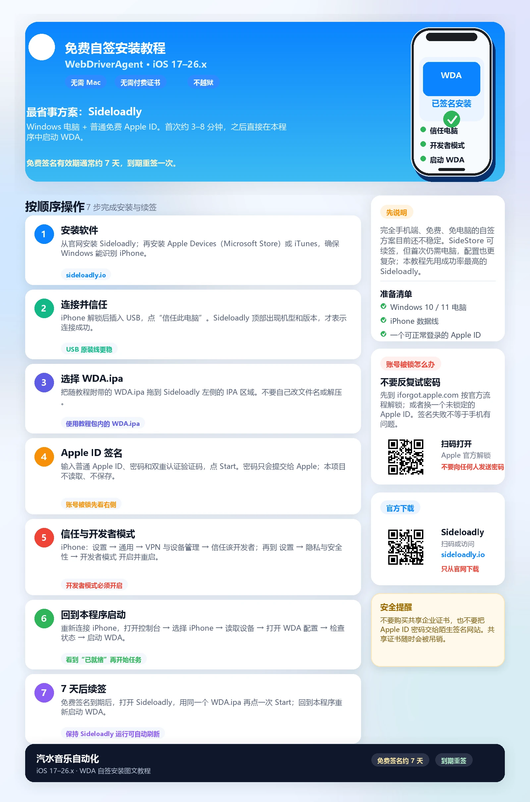

# 汽水音乐自动脚本

面向 Windows 的汽水音乐桌面辅助工具，支持 Android 与 iPhone 通过 USB 连接。提供设备识别、实时画面、任务控制、运行日志和免费听时长管理，便携版解压即可使用。

> 当前版本：`v1.4.0`
>
> 支持平台：Windows 10 / 11（64 位）、Android 7.0+、iPhone iOS 17.0+

## 功能

- Android / iPhone 双平台切换
- 自动读取手机型号、系统版本、分辨率与连接状态
- 浏览器实时预览手机画面
- 开始、停止与运行状态控制
- 自动识别并同步免费听时长
- 自定义停止上限，达到上限自动结束
- 优化领奖弹窗识别，领奖按钮优先于顶部关闭提示
- 自动退出优惠券互动页，避免卡在直播间活动弹窗
- 广告极速模式：优先识别跳过按钮，减少播放期间的无效扫描，更快接续下一条
- 设备参数自动保存，更换手机无需改代码
- 异常页面自动恢复，减少任务中断
- Android 广告播放期间自动静音，结束后恢复音量
- 内置运行环境、手机驱动助手和中文说明
- 首次启动自动检查系统、运行库、ADB 与 iPhone 驱动，并提供连接向导
- iOS 17.0–26.x 内置 WDA 安装向导，无需手动部署开发环境
- 便携版一键启动，无需单独安装 Python 或开发环境

## 兼容范围

| 平台 | 系统版本 | 连接方式 | 说明 |
|---|---|---|---|
| Android | 7.0 及以上 | USB 调试 / ADB | 常规支持 |
| iPhone | iOS 27.0 及以上 | USB 免签直连 | 不需要证书、不需要越狱；iOS 27.0 已实机验证 |
| iPhone | iOS 17.0–26.x | 内置 WebDriverAgent（WDA）向导 | 登录免费 Apple ID 后一键安装；签名通常约 7 天，需要续签 |
| iPhone | iOS 16 及以下 | 暂不支持 | 当前最低支持 iOS 17.0 |
| Windows | Windows 10 / 11 64 位 | 便携版 | 解压后直接启动 |

最低兼容范围为 Android 7.0、iPhone iOS 17.0。Apple 只在 iOS 27.0 及以上开放 CoreDevice 免签触控通道；iOS 17.0–26.x 可读取设备参数，自动点击使用内置 WDA 向导。

## 下载与启动

1. 打开 [Releases](https://github.com/guyue1337/qishui-music-automation/releases/latest)
2. 下载 Release 中最新的 `qishui-music-automation-v*-portable.zip`
3. 完整解压到硬盘，不要直接在压缩包内运行
4. 双击 `一键启动.bat`
5. 首次启动会显示环境与驱动检查，按向导选择 Android 或 iPhone
6. 浏览器打开控制台后，选择设备平台并读取手机

如果首次向导被关闭，可双击 `连接向导.bat` 或 `环境自检.bat` 重新检查。

## Android 连接

1. 打开手机开发者选项
2. 开启 USB 调试
3. 使用支持数据传输的 USB 线连接电脑
4. 手机弹出授权提示时选择允许
5. 控制台选择 Android，读取设备后开始

部分品牌还需要开启厂商提供的 USB 调试安全选项，或安装对应手机助手。

## iPhone 连接

1. 安装 Apple 官方手机驱动组件
2. iPhone 解锁后连接电脑，并选择信任此电脑
3. 在设置中开启开发者模式并重启手机
4. 控制台选择 iPhone，读取设备后开始

- **iOS 27.0 及以上**：免签 USB 直连，不需要证书、不需要越狱
- **iOS 17.0–26.x**：第一次点「开始」会自动打开兼容向导。依次完成 Apple ID 登录、安装 WDA、启动 WDA 后即可运行
- **iOS 16 及以下**：暂不支持，请先升级 iPhone 系统

iOS 17.0–26.x 的免费 Apple ID 签名通常只有约 7 天有效期，不是永久免签。到期后重新打开兼容向导，点「安装 / 续签 WDA」即可。

首次配置会联网下载签名与运行组件，并需要登录一次 Apple ID。Apple ID 密码只在 Impactor 登录窗口中输入，本项目不读取、不保存密码。

### iOS 17.0–26.x 手动签名备选方案

如果内置登录入口不稳定，或 Apple ID 被安全检查锁定，可以直接使用随包附带的 WDA 安装包，通过 Sideloadly 完成一次免费签名：

1. Windows 安装 Apple Devices（Microsoft Store）或 iTunes。
2. 从 [Sideloadly 官网](https://sideloadly.io/) 安装 Sideloadly。
3. iPhone 解锁并连接 USB，点“信任此电脑”。
4. 将 `assets/ios/WDA.ipa` 拖入 Sideloadly，输入一个可正常登录的免费 Apple ID、密码和双重认证验证码，然后点 `Start`。
5. iPhone 打开“设置 → 通用 → VPN 与设备管理”，信任该开发者。
6. iPhone 打开“设置 → 隐私与安全性 → 开发者模式”，开启并重启。
7. 回到控制台，连接 iPhone，打开 WDA 配置，点“检查状态”，再点“启动 WDA”。

免费 Apple ID 的签名通常约 7 天有效。到期后用同一个 `WDA.ipa` 在 Sideloadly 重新签名即可。若当前 Apple ID 被锁定，请先在 [Apple 官方账号恢复页面](https://iforgot.apple.com/) 解锁，或改用另一个未锁定的 Apple ID。

## 界面说明

- **设备与参数**：显示当前手机型号、系统、分辨率和连接方式
- **控制中心**：开始或停止任务，查看运行状态
- **手机画面**：实时查看当前设备屏幕
- **运行日志**：查看每个操作步骤和异常提示
- **免费听天数**：同步当前进度并设置自动停止上限

## 常见问题

### 无法读取 Android 手机

- 更换数据线或 USB 接口
- 在手机上撤销 USB 调试授权后重新连接
- 检查厂商 USB 驱动是否安装
- 小米、红米等机型确认已开启 USB 调试安全设置

### 无法读取 iPhone

- 确认 Apple 手机驱动正在运行
- 解锁手机并重新信任电脑
- 确认开发者模式已开启
- 更换数据线或 USB 接口后重试

### iPhone 点开始后出现 WDA 配置向导

这是 iOS 17.0–26.x 的系统限制。按向导依次完成：

- 打开 Apple ID 登录入口，在 Impactor 窗口完成登录
- 点「安装 / 续签 WDA」，等待进度完成
- 点「启动 WDA」，状态显示「已就绪」后返回并重新点开始

如果安装失败，请先确认 iPhone 已解锁、开发者模式已开启、USB 连接稳定，再点「检查状态」查看具体提示。

### WDA 使用几天后提示签名过期

免费 Apple ID 签名通常约 7 天到期。连接手机后打开兼容向导，点「安装 / 续签 WDA」，完成后重新启动 WDA。

如果内置登录入口不可用，按上面的 Sideloadly 流程重新拖入 `assets/ios/WDA.ipa` 签名，再回控制台启动 WDA。

### iOS 16 及以下为什么不支持

当前版本最低支持 iOS 17.0。iOS 16 及以下未纳入兼容范围，建议升级系统后使用。

### 页面提示控制台连接已断开

启动窗口被关闭后，网页将无法继续控制程序。请重新双击 `一键启动.bat`，并使用新打开的网页。

### 免费听天数显示 `--`

当前页面没有可识别信息时可能暂时无法读取，进入任务页面后会自动重新同步。

## 下个版本预告

- 评估 Android 无线调试与更多设备接入方式
- 提升金币广告挂机效率与稳定性
- 继续完善任务恢复和异常处理

## 隐私

- 所有操作均在本机完成
- 不上传截图、日志、账号或设备信息
- 设备配置和运行状态只保存在本地目录

## 免责声明

- 本项目为非官方个人项目，与汽水音乐及其运营方无关联，也不代表官方立场
- 仅用于个人学习、研究和个人设备辅助，不修改客户端、不绕过权限或安全机制
- 请遵守相关平台服务条款和当地法律法规，使用产生的账号或平台限制由使用者自行承担
- 项目不提供账号、会员、付费内容或其他受限制资源的获取能力

## 使用许可

本项目仅允许个人学习、研究与**非商业使用**。

- 禁止销售、付费分发、商业部署或以本项目直接牟利
- 转载、搬运或二次分发必须保留作者标识、项目名称和原仓库链接
- 修改后分发必须注明修改内容，不得删除原作者信息
- 使用本项目即表示同意自行承担相关风险
- 第三方组件与许可证说明见 [THIRD_PARTY_NOTICES.md](THIRD_PARTY_NOTICES.md)

完整条款见 [LICENSE](LICENSE)。

## 作者

- GitHub：[@guyue1337](https://github.com/guyue1337)

## 致谢

感谢 [cvabm/qishui](https://github.com/cvabm/qishui) 提供的早期开源实现。

本项目仅用于个人自动化研究与学习，请遵守汽水音乐及相关平台的使用规则。
