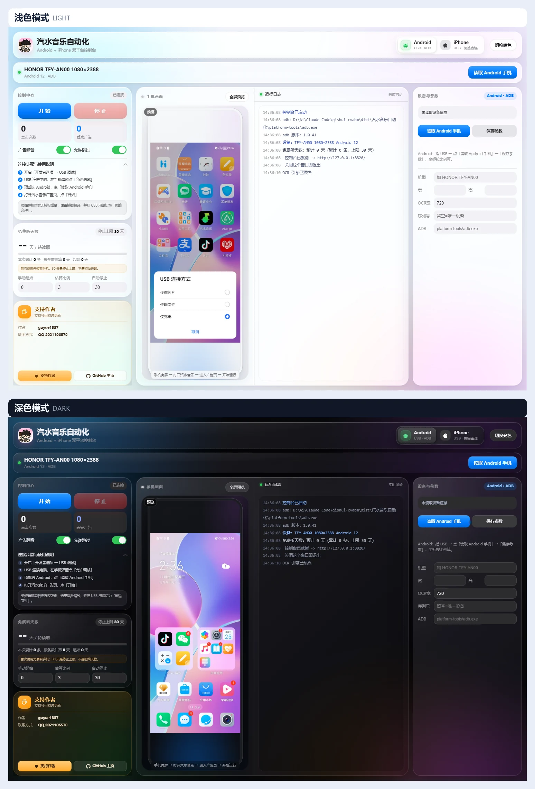

# 汽水音乐自动脚本

面向 Windows 的汽水音乐桌面辅助工具，支持 Android 与 iPhone 通过 USB 连接。提供设备识别、实时画面、任务控制、运行日志和免费听时长管理，便携版解压即可使用。

> 当前版本：`v1.2.0`
>
> 支持平台：Windows 10 / 11（64 位）、Android 7.0+、iOS 17.4+

## 功能

- Android / iPhone 双平台切换
- 自动读取手机型号、系统版本、分辨率与连接状态
- 浏览器实时预览手机画面
- 开始、停止与运行状态控制
- 自动识别并同步免费听时长
- 自定义停止上限，达到上限自动结束
- 设备参数自动保存，更换手机无需改代码
- 异常页面自动恢复，减少任务中断
- Android 广告播放期间自动静音，结束后恢复音量
- 内置运行环境、手机驱动助手和中文说明
- 便携版一键启动，无需单独安装 Python 或开发环境

## 下载与启动

1. 打开 [Releases](https://github.com/guyue1337/qishui-music-automation/releases/latest)
2. 下载最新的 `汽水音乐自动化-便携版.zip`
3. 完整解压到硬盘，不要直接在压缩包内运行
4. 双击 `一键启动.bat`
5. 浏览器打开控制台后，选择设备平台并读取手机

## Android 连接

1. 打开手机开发者选项
2. 开启 USB 调试
3. 使用支持数据传输的 USB 线连接电脑
4. 手机弹出授权提示时选择允许
5. 控制台选择 Android，读取设备后开始

部分品牌还需要开启厂商提供的 USB 调试安全选项，或安装对应手机助手。

## iPhone 连接

1. 安装 Apple 官方手机驱动组件
2. iPhone 解锁后连接电脑，并选择信任此电脑
3. 在设置中开启开发者模式并重启手机
4. 控制台选择 iPhone，读取设备后开始

首次准备环境可能需要联网下载组件，后续启动会更快。

## 界面说明

- **设备与参数**：显示当前手机型号、系统、分辨率和连接方式
- **控制中心**：开始或停止任务，查看运行状态
- **手机画面**：实时查看当前设备屏幕
- **运行日志**：查看每个操作步骤和异常提示
- **免费听天数**：同步当前进度并设置自动停止上限

## 常见问题

### 无法读取 Android 手机

- 更换数据线或 USB 接口
- 在手机上撤销 USB 调试授权后重新连接
- 检查厂商 USB 驱动是否安装
- 小米、红米等机型确认已开启 USB 调试安全设置

### 无法读取 iPhone

- 确认 Apple 手机驱动正在运行
- 解锁手机并重新信任电脑
- 确认开发者模式已开启
- 更换数据线或 USB 接口后重试

### 页面提示控制台连接已断开

启动窗口被关闭后，网页将无法继续控制程序。请重新双击 `一键启动.bat`，并使用新打开的网页。

### 免费听天数显示 `--`

当前页面没有可识别信息时可能暂时无法读取，进入任务页面后会自动重新同步。

## 下个版本预告

- 优化快进看广告体验
- 提升金币广告挂机效率与稳定性
- 继续完善任务恢复和异常处理

## 隐私

- 所有操作均在本机完成
- 不上传截图、日志、账号或设备信息
- 设备配置和运行状态只保存在本地目录

## 免责声明

- 本项目为非官方个人项目，与汽水音乐及其运营方无关联，也不代表官方立场
- 仅用于个人学习、研究和个人设备辅助，不修改客户端、不绕过权限或安全机制
- 请遵守相关平台服务条款和当地法律法规，使用产生的账号或平台限制由使用者自行承担
- 项目不提供账号、会员、付费内容或其他受限制资源的获取能力

## 使用许可

本项目仅允许个人学习、研究与**非商业使用**。

- 禁止销售、付费分发、商业部署或以本项目直接牟利
- 转载、搬运或二次分发必须保留作者标识、项目名称和原仓库链接
- 修改后分发必须注明修改内容，不得删除原作者信息
- 使用本项目即表示同意自行承担相关风险

完整条款见 [LICENSE](LICENSE)。

## 作者

- GitHub：[@guyue1337](https://github.com/guyue1337)

## 致谢

感谢 [cvabm/qishui](https://github.com/cvabm/qishui) 提供的早期开源实现。

本项目仅用于个人自动化研究与学习，请遵守汽水音乐及相关平台的使用规则。
